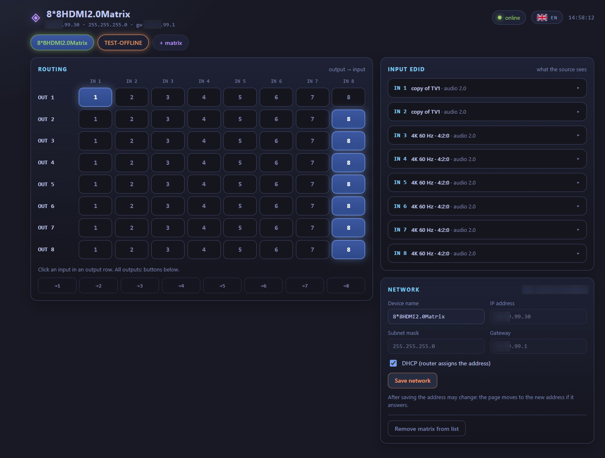

# hdmi-matrix-web-controller

**A standalone micro-service with a fast web UI for managing network-controlled HDMI 8×8 matrix switchers** — built as a replacement for the built-in web interface of the **ZENTY ZT-MT88A** 8×8 HDMI 2.0 matrix (also sold as ZT-115).

It is designed **for local networks only**: it talks to matrices on your LAN and to nothing else.

Українська версія: [README.uk.md](README.uk.md) · Project site: https://mr-addams.github.io/hdmi-matrix-web-controller/



## Why this exists

The matrix this was written for has a usable hardware front panel and a working device API, but its built-in web interface is hard to use: one page per function, no overview, no way to see several devices at once. This project keeps the same protocol and adds:

- one page with routing, EDID and network settings for the selected device;
- several matrices in one browser, each identified by its MAC address (so changing an IP does not lose it);
- network discovery: scan a private `/24` for compatible devices on a chosen port;
- online/offline status per matrix, with state preserved across reloads;
- a language switcher (English, Ukrainian, German, French, Spanish, Italian, Portuguese, Japanese, Korean, Chinese, Russian).

Nothing is sent to any external service. The page talks only to your matrices, through a single Go binary in a container.

## Quick start

Requirements: Docker with the Compose plugin, and a matrix reachable on your network.

```bash
curl -fsSLO https://raw.githubusercontent.com/mr-addams/hdmi-matrix-web-controller/main/install.sh
bash install.sh
```

The script downloads `compose.yaml` into `./hdmi-matrix`, creates `.env` with a random password (printed once) and the latest release version, pulls the published image from `ghcr.io` and starts the container. It waits until the sign-in works, then prints the address. Options: `--dir`, `--version`, `--port`, `--bind`, `--user`, `--password`; run `bash install.sh --help`.

Re-running the script keeps your `.env`. To move to another release run `bash install.sh --version 0.2.0` in the same folder, or `docker compose pull && docker compose up -d` after changing `HDMI_UI_VERSION` in `.env` yourself.

Prefer to set it up by hand? Copy `compose.yaml` and `.env.example` to a folder as `.env`, change `UI_PASSWORD`, then run `docker compose pull && docker compose up -d`. To build from source, use `docker compose -f compose.dev.yaml up -d --build`.

Open `http://127.0.0.1:8080`, sign in with the login and password from `.env`, and add a matrix by its IP address (`192.168.1.50`, or `192.168.1.50:8080` for a non-default port).

To make the page reachable from other machines on your LAN, set `MATRIX_UI_BIND=0.0.0.0` in `.env`. Read the security notes below before doing so.

## Configuration

| Variable | Default | Meaning |
| --- | --- | --- |
| `UI_USER` | `admin` | Login for the sign-in page. |
| `UI_PASSWORD` | `admin` | Password for the page. **Change it.** |
| `MATRIX_UI_PORT` | `8080` | Port the page is published on. |
| `MATRIX_UI_BIND` | `127.0.0.1` | Address the port is published on. |

## Security

- The matrix itself has **no authentication** for its web API. Anyone who can reach it on the network can switch inputs. Keep matrices on a trusted network segment.
- The proxy only forwards to private addresses (`10.x`, `192.168.x`, `172.16–31.x`) and to TCP ports 1–65535. Other destinations return 403/400.
- The sign-in password is set from environment variables at container start and is not stored in the image. The default `admin` is weak: change it before exposing the page. Sessions live in memory: a restart signs everyone out. Behind an HTTPS proxy set `COOKIE_SECURE=true`.
- Report vulnerabilities privately, see [SECURITY.md](SECURITY.md).

## How it works

- `static/` — the page: plain HTML, CSS and ES modules, no build step.
- `static/protocol.js` — the matrix protocol as used by the device's own web UI. Pure functions, unit-testable in Node.
- `static/lang/*.json` — interface translations; English is the default and fallback.
- `main.go`, `auth.go`, `proxy.go`, `config.go` — the server: sign-in page and session cookie, static files (embedded with `go:embed`), the matrix proxy with its private-network and port checks, and the settings API (`/api/config`). Settings are stored in `/data/config.json` in the `matrix-data` volume; writes are atomic.
- The image is built on distroless `static-debian13`: no shell, no package manager, no nginx.

Run the tests without Docker: `go test -race ./...`.

Protocol notes are in [docs/PROTOCOL.md](docs/PROTOCOL.md).

## Supported devices

| Device | Status | Notes |
| --- | --- | --- |
| ZENTY ZT-MT88A (ZT-115) | Tested | 8×8 HDMI 2.0, HTTP API on port 80, device name `8*8HDMI2.0Matrix`, firmware 1.04 |
| Similar 8×8 HDMI matrices, e.g. Monoprice Blackbird 4K 8×8, OREI UHD-808 | Not tested | Other vendors use other control protocols; discovery will not recognise them, so they are not supported |

Discovery only accepts devices that answer like the ZT-MT88A does. ZENTY and ZT-MT88A are trademarks of their owner; this project is not affiliated with the vendor.

## Limitations

- The TCP control port (5000) described in the vendor's Savant driver is **not** used: its command format was not confirmed on the device.
- Network discovery is limited to `/24` per run.
- The page needs the matrix to be reachable from the machine running the container.

## Contributing

Issues and pull requests are welcome. Please read [CONTRIBUTING.md](CONTRIBUTING.md) and [CODE_OF_CONDUCT.md](CODE_OF_CONDUCT.md) first.

## License

[MIT](LICENSE). ZENTY and ZT-MT88A are trademarks of their owner; this project is not affiliated with the vendor.
