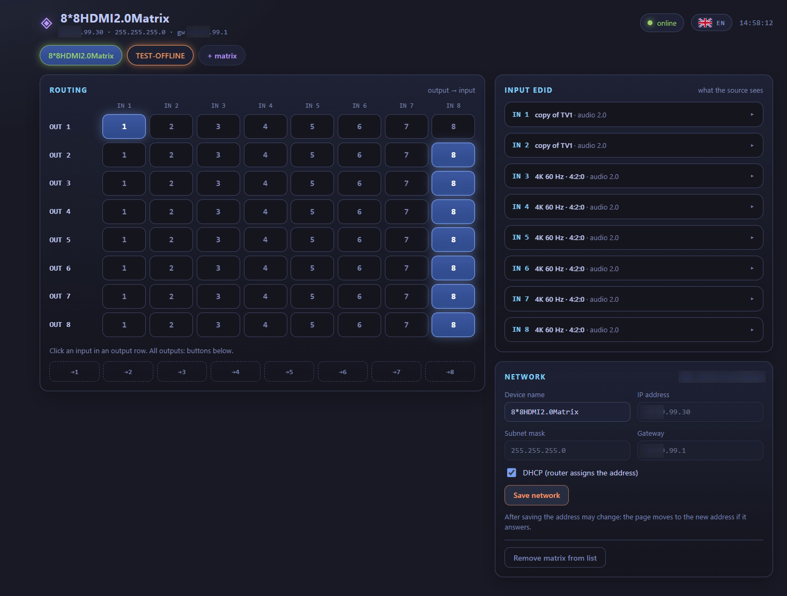

# hdmi-matrix-web-controller

**Окремий мікросервіс зі швидким веб-інтерфейсом для керування HDMI-матрицями 8×8 з керуванням по мережі** — створений як заміна вбудованого веб-інтерфейсу матриці **ZENTY ZT-MT88A** 8×8 HDMI 2.0 (вона ж ZT-115).

Призначений **лише для локальних мереж**: він звертається до матриць у вашій LAN і ні до чого більше.

English version: [README.md](README.md) · Сайт проєкту: https://mr-addams.github.io/hdmi-matrix-web-controller/



## Навіщо це

Матриця, для якої писався проєкт, має зручну апаратну панель і робочий API пристрою, але її вбудований веб-інтерфейс незручний: одна сторінка на кожну функцію, немає загального огляду, не можна побачити кілька пристроїв одразу. Проєкт зберігає той самий протокол і додає:

- одну сторінку з маршрутизацією, EDID і налаштуваннями мережі для обраного пристрою;
- кілька матриць в одному браузері, кожна ідентифікується за MAC-адресою, тож зміна IP не втрачає запис;
- пошук у мережі: скан приватної мережі `/24` на потрібному порту;
- статус онлайн/офлайн для кожної матриці, стан зберігається після перезавантаження;
- перемикач мови (англійська, українська, німецька, французька, іспанська, італійська, португальська, японська, корейська, китайська, російська).

Ніяких запитів до зовнішніх сервісів: сторінка звертається лише до ваших матриць через один бінарник Go у контейнері.

## Швидкий старт

Потрібні: Docker з плагіном Compose і матриця, доступна у вашій мережі.

```bash
git clone https://github.com/mr-addams/hdmi-matrix-web-controller.git
cd hdmi-matrix-web-controller
./install.sh
```

Скрипт створює `.env` із випадковим паролем (показується один раз), збирає образ, запускає контейнер і чекає, поки сторінка відповість із логіном. Параметри: `--port`, `--bind`, `--user`, `--password`; довідка — `./install.sh --help`. Наявний `.env` залишається без змін.

Хочете налаштувати вручну? Скопіюйте `.env.example` у `.env`, змініть `UI_PASSWORD` і виконайте `docker compose up -d --build`.

Відкрийте `http://127.0.0.1:8080`, увійдіть з логіном і паролем із `.env` і додайте матрицю за IP-адресою (`192.168.1.50` або `192.168.1.50:8080`, якщо порт не стандартний).

Щоб сторінка була доступна з інших машин у локальній мережі, встановіть `MATRIX_UI_BIND=0.0.0.0` у `.env`. Перед цим прочитайте розділ про безпеку.

## Налаштування

| Змінна | Типове значення | Призначення |
| --- | --- | --- |
| `UI_USER` | `admin` | Логін для сторінки входу. |
| `UI_PASSWORD` | `admin` | Пароль для сторінки. **Змініть його.** |
| `MATRIX_UI_PORT` | `8080` | Порт, на якому опубліковано сторінку. |
| `MATRIX_UI_BIND` | `127.0.0.1` | Адреса, на якій опубліковано порт. |

## Безпека

- Сама матриця **не має автентифікації** для веб-API. Будь-хто, хто дістанеться до неї в мережі, може перемикати входи. Тримайте матриці в довіреному сегменті мережі.
- Проксі пересилає запити лише на приватні адреси (`10.x`, `192.168.x`, `172.16–31.x`) і TCP-порти 1–65535. Інші цілі отримують відповідь 403/400.
- Пароль для входу задається змінними середовища під час запуску контейнера і не зберігається в образі. Типове `admin` слабке: змініть його, перш ніж відкривати сторінку назовні. Сесії живуть у пам'яті: після перезапуску вихід із усіх. За HTTPS-проксі задайте `COOKIE_SECURE=true`.
- Про вразливості повідомляйте приватно, див. [SECURITY.md](SECURITY.md).

## Як це працює

- `static/` — сторінка: звичайні HTML, CSS і ES-модулі без етапу збірки.
- `static/protocol.js` — протокол матриці, як його використовує вбудований веб-інтерфейс пристрою. Чисті функції, які можна перевірити в Node.
- `static/lang/*.json` — переклади інтерфейсу; англійська — типова мова і запасна.
- `main.go`, `auth.go`, `proxy.go`, `config.go` — сервер: сторінка входу і cookie сесії, статика (вбудована через `go:embed`), проксі до матриць із перевірками приватних мереж і порту, та API налаштувань (`/api/config`). Налаштування зберігаються в `/data/config.json` у томі `matrix-data`; запис атомарний.
- Образ зібрано на distroless `static-debian13`: без shell, без менеджера пакетів, без nginx.

Тести без Docker: `go test -race ./...`.

Нотатки про протокол — у [docs/PROTOCOL.md](docs/PROTOCOL.md).

## Підтримувані пристрої

| Пристрій | Статус | Примітки |
| --- | --- | --- |
| ZENTY ZT-MT88A (ZT-115) | Перевірено | 8×8 HDMI 2.0, HTTP API на порту 80, назва пристрою `8*8HDMI2.0Matrix`, прошивка 1.04 |
| Схожі HDMI-матриці 8×8, наприклад Monoprice Blackbird 4K 8×8, OREI UHD-808 | Не перевірено | Інші виробники використовують інші протоколи керування; пошук їх не розпізнає, тож вони не підтримуються |

Пошук приймає лише пристрої, які відповідають ZT-MT88A. ZENTY і ZT-MT88A — торгові марки їхнього власника; проєкт не пов'язаний з виробником.

## Обмеження

- TCP-порт керування (5000), описаний у драйвері Savant від виробника, **не використовується**: формат команд на пристрої не підтверджено.
- Пошук у мережі обмежено `/24` за один запуск.
- Для роботи сторінки матриця має бути доступна з машини, де запущено контейнер.

## Участь у розробці

Issues і pull request-и вітаються. Спочатку прочитайте [CONTRIBUTING.md](CONTRIBUTING.md) і [CODE_OF_CONDUCT.md](CODE_OF_CONDUCT.md).

## Ліцензія

[MIT](LICENSE). ZENTY і ZT-MT88A є торговельними марками їхнього власника; цей проєкт не пов'язаний з виробником.
